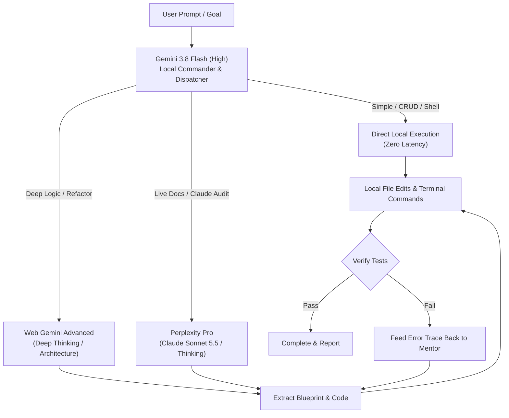

# Autonomous Multi-Model Orchestrator Skill

An autonomous agent orchestration skill designed for **Gemini 3.8 Flash (High)** that dynamically routes tasks to the optimal model—balancing real-time local execution with web-grounded reasoning from **Google Gemini Advanced** and **Perplexity Pro (Claude Sonnet 5.5 / Thinking)**.

---

## Overview

When developing software with AI agents, a single model tier is rarely optimal for every task:
- Fast models excel at rapid file editing, CLI commands, and straightforward logic, but may struggle with deep architecture designs.
- Ultra-high-tier models excel at abstract reasoning and real-time research, but incur latency and web overhead if used for every minor change.

The **Autonomous Multi-Model Orchestrator** positions local **Gemini 3.8 Flash (High)** as the Commander and Dispatcher. It evaluates task complexity in real time and automatically summons the right mentor via a sandboxed browser subagent before executing code locally.



---

## Autonomous Decision Matrix

| Tier | Characteristics | Primary Engine | Execution Mode |
| :--- | :--- | :--- | :--- |
| **Tier 1: Direct Local** | Single-file edits, unit tests, shell commands, syntax fixes | **Gemini 3.8 Flash (High)** | Native local execution without browser overhead |
| **Tier 2: Deep Architecture** | Complex domain modeling, multi-file refactoring, algorithms | **Web Gemini Advanced** | Dispatches via browser subagent, extracts blueprint, applies code |
| **Tier 3: Live Research & Audit** | Recent framework changes, breaking APIs, Claude Sonnet audit | **Perplexity Pro** | Queries Perplexity via browser subagent, extracts code with citations |

---

## Repository Structure

```text
autonomous-model-orchestrator-skill/
├── .agents/
│   └── skills/
│       └── autonomous-model-orchestrator/
│           └── SKILL.md         # Antigravity skill specification
├── autonomous-model-orchestrator/
│   └── SKILL.md                 # Standalone skill file
├── README.md                    # English documentation
└── .gitignore                   # Ignore rules
```

---

## Quick Setup

### 1. Install as a Workspace Skill

Copy the skill definition into your project's `.agents/skills` folder:

```bash
mkdir -p .agents/skills/autonomous-model-orchestrator
cp autonomous-model-orchestrator/SKILL.md .agents/skills/autonomous-model-orchestrator/SKILL.md
```

### 2. Configure Companion Rule

Place the orchestration rule into your workspace root as `GEMINI.md`:

```markdown
# Autonomous Multi-Model Routing Protocol

The local agent operates with Gemini 3.8 Flash (High) as the dispatcher.
For any user task, evaluate whether:
1. It can be solved directly locally;
2. It requires Web Gemini Advanced (deep thinking / architecture);
3. It requires Perplexity Pro (Claude Sonnet 5.5 / live documentation).
Summon the appropriate browser subagent autonomously, retrieve the solution, and implement it locally.
```

### 3. One-Time Browser Authentication

Ensure you have completed a one-time sign-in on both `https://gemini.google.com` and `https://www.perplexity.ai` inside your agent browser. Session cookies persist automatically.

---

## Usage

Simply submit your normal requests. The agent transparently evaluates and routes each task:

- **Routine Task**:
  > *"Add a helper function to format timestamps in utils.py"*
  > *(Agent executes directly locally with Gemini 3.8 Flash)*

- **Deep Architecture Task**:
  > *"Design a fault-tolerant event-sourcing pipeline for our distributed order service"*
  > *(Agent autonomously summons Web Gemini Advanced, retrieves architecture, and implements code)*

- **Live Research Task**:
  > *"Update our project to use the latest FastAPI 2026 syntax and verify breaking changes"*
  > *(Agent autonomously summons Perplexity Pro with Claude Sonnet 5.5, extracts docs, and refactors)*
