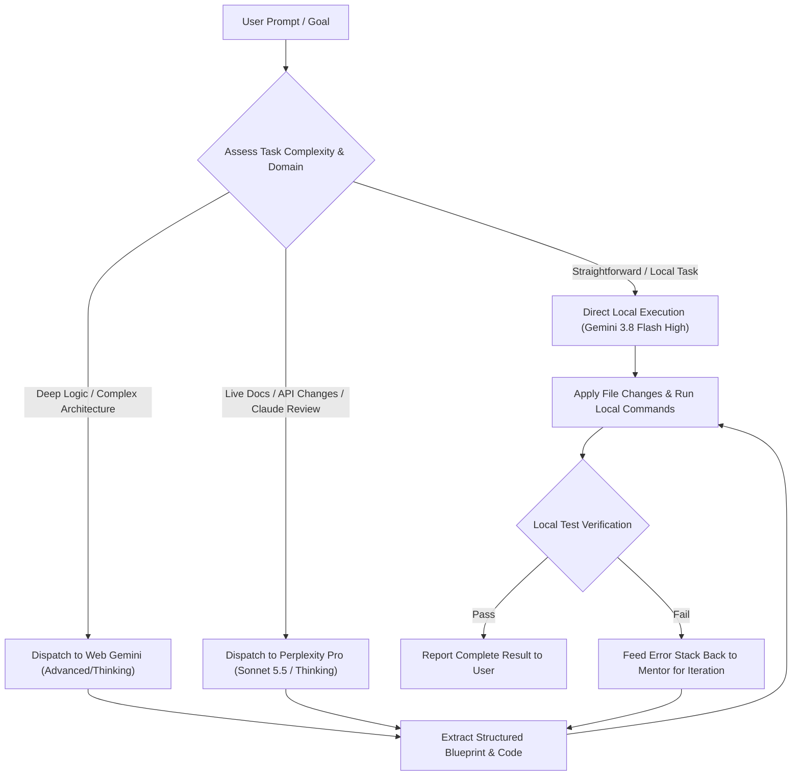

# Autonomous Multi-Model Orchestrator Skill

This skill turns the local **Gemini 3.8 Flash (High)** agent into an **Autonomous Commander & Dispatcher**:
- **Dispatcher & Executor (Gemini 3.8 Flash High)**: Provides high-speed task decomposition, native file/terminal operations, and local verification.
- **Deep Architecture Mentor (Web Gemini Advanced)**: Engaged autonomously for difficult algorithmic challenges, complex domain modeling, and multi-file architecture refactoring.
- **Live Research & Review Mentor (Perplexity Pro / Claude Sonnet / Thinking)**: Engaged autonomously for real-time web documentation lookups, recent SDK breaking changes, and Claude Sonnet 5.5 multi-perspective code reviews.

---

## Autonomous Decision Matrix

Whenever the user submits a task, the agent automatically evaluates the problem against three operational tiers:

| Tier | Task Characteristics | Selected Engine | Execution Action |
| :--- | :--- | :--- | :--- |
| **Tier 1: Direct Local** | Simple scripts, CRUD updates, standard shell commands, unit test runs, single-file bugfixes | **Gemini 3.8 Flash (High)** | Executes locally in real-time with zero browser overhead. |
| **Tier 2: Deep Logic Mentor** | System architecture design, difficult algorithmic proofs, large-scale refactoring, Google stack integrations | **Web Gemini Advanced** (`gemini.google.com`) | Automatically dispatches prompt via browser subagent, extracts blueprint, and executes code locally. |
| **Tier 3: Live Research Mentor** | Breaking library changes, recent framework APIs (2024-2026), live web documentation, Claude Sonnet 5.5 code audits | **Perplexity Pro** (`perplexity.ai`) | Automatically queries Perplexity via browser subagent, extracts verified code & citations, and implements locally. |

---

## Autonomous Execution Lifecycle

---

## Operational Runbook

### 1. Transparent Classification
When receiving a task, inform the user in one sentence which route was selected:
- Example: *"Detected complex architectural design task. Consulting Web Gemini Advanced for deep reasoning before local implementation..."*
- Example: *"Detected latest library integration request. Consulting Perplexity Pro for real-time documentation verification..."*

### 2. Browser Engagement Protocol
- Reuses authenticated browser sessions (`agent-tab-1` or existing browser subagent).
- Maintains session cookies without logging out.
- Structures prompts cleanly with project context, environment constraints, and request for executable code blocks.

### 3. Local Implementation & Grounding
- Uses `write_file` or `edit_file` to apply modifications.
- Runs verification commands in standard sandbox mode.
- If runtime errors occur, captures standard error outputs and performs automated closed-loop recovery with the mentor.
